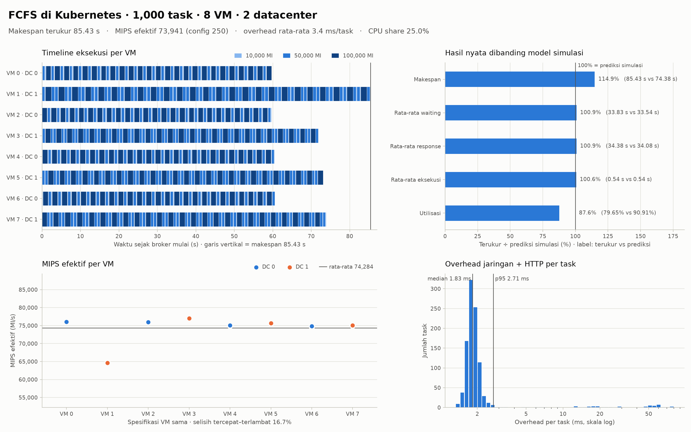
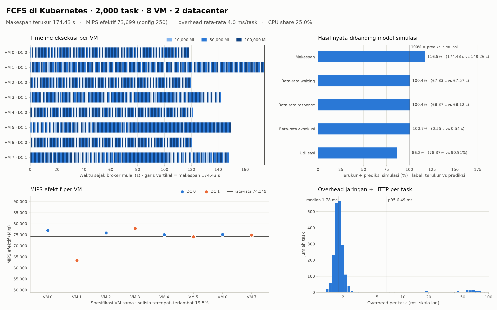

# FCFS di Kubernetes (real case)

Simulasi di `fcfs/` *menghitung* waktu dengan rumus `length / mips`. Versi ini
*menjalankan* task yang sama di cluster Kubernetes sungguhan: setiap VM adalah
pod dengan batas CPU, setiap datacenter adalah node (host), dan broker FCFS adalah Job.
Waktu start, finish, waiting, dan response **diukur**, termasuk overhead jaringan,
throttling CPU, dan gangguan lain yang tidak ada di simulasi.

## Ringkasan: menjalankan dalam 4 langkah

```bash
# 1. Prasyarat (sekali saja, Arch/CachyOS)
sudo pacman -S --needed kubectl kind
sudo systemctl enable --now docker

# 2. Atur eksperimen di satu file: tasks, vms, datacenters, spesifikasi VM, workload
$EDITOR fcfs/config.json

# 3. Buat cluster, build image, deploy VM, jalankan broker, ambil hasil
k8s/fcfs-k8s.sh all

# 4. Buka grafik, lalu hapus cluster jika sudah selesai
xdg-open results/k8s-fcfs-*/k8s_metrics.png
k8s/fcfs-k8s.sh down
```

Untuk eksperimen berikutnya di cluster yang sama cukup ubah config lalu
`k8s/fcfs-k8s.sh run`. Penjelasan tiap langkah ada di [bagian 3](#3-langkah-manual-untuk-memahami-tiap-komponen).

## Satu sumber alokasi: `fcfs/config.json`

Semua alokasi berasal dari satu file. File yang sama dipakai simulasi, dirender
menjadi manifest, dan dimuat ke cluster sebagai ConfigMap `fcfs-config`:

| Field di `config.json` | Menentukan | Dipakai oleh |
|---|---|---|
| `datacenters` | jumlah node worker (host), label `zone=dc-N`, jumlah StatefulSet | `render.py kind`, `render.py vms` |
| `vms` | replicas tiap StatefulSet (VM `v` → DC `v mod datacenters`) | `render.py vms` (memakai `create_vms`) |
| `vm.mips × vm.pes_number` | CPU request = limit pod (1 MIPS = 1 millicore) | `render.py vms` |
| `vm.ram` | memory request = limit pod (MiB) | `render.py vms` |
| `tasks`, `workload`, `cloudlet` | jumlah, panjang, dan spesifikasi cloudlet | broker, dari ConfigMap |

`render.py` memakai fungsi validasi dan alokasi yang sama dengan simulasi
(`parse_arguments`, `create_vms`), jadi config yang ditolak simulasi juga ditolak
saat render. Broker memeriksa ulang setiap VM sebelum eksperimen: ID VM, datacenter,
batas CPU, dan batas memori yang terbaca dari cgroup pod harus sama dengan config.
Jika tidak sama, eksperimen dibatalkan. `run` juga menolak opsi `--tasks`, `--vms`,
dan `--datacenters`, sehingga alokasi tidak bisa diubah di luar config.

Yang tidak berasal dari config: kapasitas fisik node. Node kind berbagi CPU laptop;
Kubernetes hanya mencadangkan tepat sebesar request VM (`requests = limits`, QoS
*Guaranteed*). `bandwidth`, `size`, dan `vmm` dicatat tetapi tidak dimodelkan.

## Arsitektur

```
                         cluster kind "soka-fcfs"
 ┌────────────────────────────────────────────────────────────────────┐
 │ node control-plane      node worker (dc-0)     node worker (dc-1)  │
 │ ┌──────────────────┐    ┌──────────────────┐   ┌──────────────────┐│
 │ │ Job fcfs-broker  │    │ StatefulSet      │   │ StatefulSet      ││
 │ │  baca ConfigMap  │HTTP│ fcfs-vm-dc0      │   │ fcfs-vm-dc1      ││
 │ │  task i -> VM i%N├───►│  -0 = VM 0       │   │  -0 = VM 1       ││
 │ │  ukur waktu      ├────┼──────────────────┼──►│  -1 = VM 3       ││
 │ └────────┬─────────┘    │  -1 = VM 2  ...  │   │  -2 = VM 5  ...  ││
 │          │ hasil        │  250m CPU / pod  │   │  250m CPU / pod  ││
 │   PVC fcfs-results      └──────────────────┘   └──────────────────┘│
 └────────────────────────────────────────────────────────────────────┘
        │ kubectl cp
        ▼
   results/k8s-fcfs-<task>task-<vm>vm-<dc>dc-<waktu>/
```

| Simulasi | Kubernetes | File |
|---|---|---|
| Datacenter / host | Node worker berlabel `topology.kubernetes.io/zone=dc-N` | `render.py kind` |
| VM | Pod StatefulSet `fcfs-vm-dc<D>-<i>` (VM ID = `i × jumlah DC + D`) | `templates/vm-datacenter.yaml` |
| DatacenterBroker FCFS | Job `fcfs-broker` | `manifests/broker-job.yaml` |
| Cloudlet sepanjang L MI | `POST /execute`: `L × work_per_mi` iterasi CPU | `fcfs/fcfs_worker.py` |
| Folder `results/` | PersistentVolumeClaim `fcfs-results` | `manifests/results-pvc.yaml` |

### Alur satu eksperimen

1. Broker membaca config dari ConfigMap, lalu membuat dataset task. Dataset
   deterministik, jadi urutan task **identik** dengan simulasi untuk config yang sama.
2. *Preflight*: broker memanggil `GET /info` di setiap VM dan memeriksa ID, datacenter,
   CPU, dan memori terhadap config.
3. Task ke-i dikirim ke VM `i mod jumlah_VM` (aturan sama dengan `fcfs_schedule`).
   Setiap VM punya antrean sendiri; task berikutnya baru dikirim setelah task
   sebelumnya selesai (1 PE, *space-shared*). Semua VM berjalan paralel.
4. `start_time` = saat broker mengirim task, `finish_time` = saat respons diterima.
   VM juga melaporkan waktu eksekusi murni dan CPU time yang dipakai.
5. Broker menjalankan simulasi FCFS untuk dataset yang sama, lalu membandingkannya
   dengan hasil terukur dan membuat grafik.

## 1. Prasyarat (sekali saja)

```bash
sudo pacman -S --needed kubectl kind
sudo systemctl enable --now docker
docker info --format '{{.ServerVersion}}'
```

User harus anggota grup `docker`; cek dengan `groups`.

## 2. Jalan cepat

Dari root proyek:

```bash
k8s/fcfs-k8s.sh all
```

Perintah itu membuat cluster sesuai `datacenters`, build image, memasang VM sesuai
config, menjalankan broker, lalu menyalin hasil ke
`results/k8s-fcfs-<task>task-<vm>vm-<dc>dc-<waktu>/`.

| Perintah | Fungsi |
|---|---|
| `k8s/fcfs-k8s.sh render` | tampilkan manifest kind dan VM hasil render config |
| `k8s/fcfs-k8s.sh run` | deploy ulang sesuai config, jalankan broker, ambil hasil |
| `k8s/fcfs-k8s.sh status` | node, pod VM, Job, PVC |
| `k8s/fcfs-k8s.sh down` | hapus cluster |
| `CONFIG=path/lain.json k8s/fcfs-k8s.sh run` | eksperimen dengan config lain |

Setelah mengubah kode Python, jalankan `k8s/fcfs-k8s.sh build` lalu hapus pod VM
agar memakai image baru: `kubectl -n fcfs delete pod -l app.kubernetes.io/name=fcfs-vm`.

### Memeriksa cluster (untuk demo)

| Perintah | Yang ditunjukkan |
|---|---|
| `kubectl get nodes -L topology.kubernetes.io/zone` | node = datacenter/host (kolom `ZONE`) |
| `kubectl -n fcfs get pods -o wide` | pod VM dan node tempatnya (kolom `NODE`) |
| `kubectl -n fcfs logs -f job/fcfs-broker` | log broker saat `run` berjalan |
| `kubectl -n fcfs describe pod fcfs-vm-dc0-0` | batas VM dari config: CPU `250m`, memori `512Mi` |

Contoh output dengan config default (2 datacenter, 8 VM):

```console
$ kubectl get nodes -L topology.kubernetes.io/zone
NAME                      STATUS   ROLES           AGE   VERSION   ZONE
soka-fcfs-control-plane   Ready    control-plane   32m   v1.37.0
soka-fcfs-worker          Ready    <none>          32m   v1.37.0   dc-0
soka-fcfs-worker2         Ready    <none>          32m   v1.37.0   dc-1

$ kubectl -n fcfs get pods -o wide
NAME                READY   STATUS      ...   NODE
fcfs-broker-hdtxk   0/1     Completed   ...   soka-fcfs-control-plane
fcfs-vm-dc0-0       1/1     Running     ...   soka-fcfs-worker
fcfs-vm-dc0-1       1/1     Running     ...   soka-fcfs-worker
...                                           (8 pod VM: dc0-0..3, dc1-0..3)

$ kubectl -n fcfs describe pod fcfs-vm-dc0-0
    Limits:
      cpu:     250m
      memory:  512Mi
    Requests:
      cpu:      250m
      memory:   512Mi
```

Node control-plane tidak berlabel zone karena bukan datacenter. Ia menjalankan
Kubernetes sendiri dan broker FCFS, supaya broker tidak memakai CPU VM.

## 3. Langkah manual (untuk memahami tiap komponen)

Skrip hanya merangkai perintah berikut. Jalankan satu per satu saat belajar.

### 3.1 Cluster: node sebagai datacenter

```bash
python3 k8s/render.py kind fcfs/config.json > /tmp/kind-fcfs.yaml
cat /tmp/kind-fcfs.yaml
kind create cluster --name soka-fcfs --config /tmp/kind-fcfs.yaml
kubectl get nodes -L topology.kubernetes.io/zone
```

Dengan `datacenters: 2` hasilnya tiga node: `soka-fcfs-control-plane`,
`soka-fcfs-worker` (zone `dc-0`), dan `soka-fcfs-worker2` (zone `dc-1`). Setiap
node kind adalah container Docker yang menjalankan kubelet dan containerd.

### 3.2 Image: satu image untuk VM dan broker

```bash
docker build -t fcfs-k8s:dev -f k8s/Dockerfile fcfs
kind load docker-image fcfs-k8s:dev --name soka-fcfs
```

`kind load` menyalin image ke containerd setiap node, jadi tidak perlu registry.

### 3.3 Namespace, ConfigMap, penyimpanan, dan VM

```bash
kubectl apply -f k8s/manifests/namespace.yaml
kubectl -n fcfs create configmap fcfs-config --from-file=config.json=fcfs/config.json
kubectl apply -f k8s/manifests/results-pvc.yaml
python3 k8s/render.py vms fcfs/config.json | kubectl apply -f -
kubectl -n fcfs rollout status statefulset/fcfs-vm-dc0
kubectl -n fcfs rollout status statefulset/fcfs-vm-dc1
kubectl -n fcfs get pods -o wide
```

Kolom `NODE` menunjukkan semua pod `fcfs-vm-dc0-*` di node dc-0 dan
`fcfs-vm-dc1-*` di node dc-1 karena `nodeSelector` di template. Headless Service
memberi DNS per pod, misalnya `fcfs-vm-dc1-2.fcfs-vm-dc1` untuk VM 5.

### 3.4 Coba satu VM secara langsung

Terminal 1:

```bash
kubectl -n fcfs port-forward pod/fcfs-vm-dc0-0 8080:8080
```

Terminal 2:

```bash
curl -s localhost:8080/info
curl -s -X POST localhost:8080/execute -d '{"task_id": 1, "length_mi": 10000, "iterations": 200000}'
```

`/info` menampilkan `cpu_limit_millicores: 250` yang dibaca dari cgroup pod.
Pada `/execute`, `cpu_time_s` sekitar 25% dari `exec_time_s`: kernel hanya
memberi pod 25 ms CPU setiap periode 100 ms. Inilah "MIPS" VM dalam bentuk nyata.

### 3.5 Jalankan broker

```bash
kubectl apply -f k8s/manifests/broker-job.yaml
kubectl -n fcfs logs -f job/fcfs-broker
kubectl -n fcfs get job fcfs-broker
```

Job tidak diulang bila gagal (`backoffLimit: 0`), sehingga eksperimen yang rusak
terlihat jelas. Untuk menjalankan ulang, hapus dulu: `kubectl -n fcfs delete job fcfs-broker`.

### 3.6 Ambil hasil dari PVC

```bash
kubectl apply -f k8s/manifests/results-reader.yaml
kubectl -n fcfs wait --for=condition=Ready pod/fcfs-results-reader
kubectl -n fcfs cp fcfs-results-reader:/results/fcfs-k8s results/k8s-fcfs-manual
kubectl -n fcfs delete pod fcfs-results-reader
```

## 4. Membaca hasil

Folder hasil memuat file yang sama dengan simulasi (`summary.json`, `results.csv`,
`vm_metrics.csv`, `datacenter_metrics.csv`, `dataset.csv`, `config.json`,
`vms.csv`, `metrics.png`) ditambah:

| File | Isi |
|---|---|
| `k8s_metrics.png` | grafik khusus eksekusi nyata (dijelaskan di bawah) |
| `k8s_comparison.csv` | per metrik: nilai simulasi, prediksi dalam detik nyata, terukur, rasio |
| `k8s_vms.csv` | VM → pod, node, batas CPU/memori dari cgroup, MIPS efektif |
| `k8s_tasks.csv` | per task: waktu eksekusi di VM, CPU time, overhead jaringan |
| `k8s_summary.json` | `work_per_mi`, MIPS efektif, overhead rata-rata, CPU share, perbandingan |

### Skala waktu simulasi vs nyata

Di cluster, 1 MI = `work_per_mi` iterasi CPU, sehingga task selesai jauh lebih
cepat daripada VM 250 MIPS di simulasi. Broker mengukur skala itu sendiri:

- `effective_mips`: MI per detik yang benar-benar dicapai pod.
- `speedup_vs_simulation` = `effective_mips / configured_mips`.
- **Prediksi** = nilai simulasi ÷ speedup (untuk waktu), sehingga 100% berarti
  hasil nyata persis sesuai model. Selisih dari 100% adalah efek dunia nyata.

### Empat panel `k8s_metrics.png`

1. **Timeline eksekusi per VM**: satu baris per VM, satu blok per task, warna =
   panjang task. Terlihat antrean FCFS dan VM mana yang selesai terakhir (penentu makespan).
2. **Hasil nyata dibanding model simulasi**: rasio terukur ÷ prediksi untuk
   makespan, waiting, response, eksekusi, dan utilisasi.
3. **MIPS efektif per VM**: VM berspesifikasi sama ternyata tidak sama cepat di dunia nyata.
4. **Overhead jaringan + HTTP per task**: distribusi selisih waktu yang dilihat
   broker dengan waktu eksekusi di VM. Outlier ditulis terpisah.

### Contoh hasil: 1000 dan 2000 task

Lingkungan: laptop AMD Ryzen 7 6800H (8 core / 16 thread), kind dengan 1 control-plane
+ 2 worker, config default (8 VM 250 MIPS, 2 datacenter, workload 50/30/20%),
`work_per_mi` 20. Kolom **Simulasi** adalah hasil `fcfs_schedule` untuk dataset yang
sama (identik dengan `fcfs_scheduler.py`); **Prediksi** adalah simulasi yang
diskalakan ke detik nyata dengan speedup terukur (sekitar 295×).
Degree of imbalance untuk dua run ini dihitung dari `vm_metrics.csv`, karena run
tersebut dibuat sebelum metrik ini ditambahkan; run baru menulisnya langsung di
`summary.json` dan `k8s_comparison.csv`.

**1000 task**: [`results/k8s-fcfs-1000task-8vm-2dc-20261025-232457`](../results/k8s-fcfs-1000task-8vm-2dc-20261025-232457)

| Metrik | Simulasi | Prediksi | Terukur | Terukur ÷ prediksi |
|---|---:|---:|---:|---:|
| Makespan | 22.000 s | 74,38 s | 85,43 s | 114,9% |
| Rata-rata waiting | 9.920 s | 33,54 s | 33,83 s | 100,9% |
| Rata-rata response | 10.080 s | 34,08 s | 34,38 s | 100,9% |
| Rata-rata eksekusi | 160 s | 0,541 s | 0,544 s | 100,6% |
| Throughput | 0,0455 task/s | 13,44 task/s | 11,70 task/s | 87,1% |
| Utilisasi | 90,91% | 90,91% | 79,65% | 87,6% |
| Degree of imbalance | 0,200 | 0,200 | 0,379 | 189,2% |



**2000 task**: [`results/k8s-fcfs-2000task-8vm-2dc-20261025-232803`](../results/k8s-fcfs-2000task-8vm-2dc-20261025-232803)

| Metrik | Simulasi | Prediksi | Terukur | Terukur ÷ prediksi |
|---|---:|---:|---:|---:|
| Makespan | 44.000 s | 149,26 s | 174,43 s | 116,9% |
| Rata-rata waiting | 19.920 s | 67,57 s | 67,83 s | 100,4% |
| Rata-rata response | 20.080 s | 68,12 s | 68,37 s | 100,4% |
| Rata-rata eksekusi | 160 s | 0,543 s | 0,547 s | 100,7% |
| Throughput | 0,0455 task/s | 13,40 task/s | 11,47 task/s | 85,6% |
| Utilisasi | 90,91% | 90,91% | 78,37% | 86,2% |
| Degree of imbalance | 0,200 | 0,200 | 0,412 | 206,2% |



### Pembahasan

1. **Perilaku antrean FCFS sesuai model.** Rata-rata waiting, response, dan eksekusi
   hanya menyimpang 0,4–0,9% dari prediksi simulasi. Waktu waiting yang mendominasi
   response (98–99%) juga muncul di cluster: task di akhir antrean menunggu
   semua task sebelumnya di VM yang sama.
2. **Makespan ditentukan VM paling lambat.** Pod `fcfs-vm-dc1-0` (VM 1) mencapai
   63.000–65.000 MIPS efektif, sekitar 15% di bawah VM lain (±75.000), pada kedua run.
   Karena makespan = waktu selesai VM terakhir, makespan naik 15–17%, sedangkan VM lain
   menganggur menunggu sehingga throughput dan utilisasi turun. Simulasi menganggap
   semua VM identik, jadi efek ini tidak terlihat di sana. Degree of imbalance
   (selisih busy time VM tersibuk dan tersepi dibagi rata-ratanya) naik dari 0,20 di
   simulasi menjadi 0,38–0,41. Nilai 0,20 di simulasi berasal dari pola workload yang
   memberi VM di DC 1 lebih banyak task panjang. FCFS dengan pembagian statis
   (`task i → VM i mod N`) juga tidak bisa mengalihkan task dari VM yang lambat; ini
   kelemahan FCFS yang menjadi motivasi algoritma yang memperhitungkan beban VM.
   Pada dua run sebelumnya dengan config yang sama (pod lain), rasio makespan 99,9%
   (1000 task) dan 99,7% (2000 task), jadi VM lambat tidak selalu muncul.
   Penyebab pastinya belum diverifikasi; dugaan: pod berbagi core fisik (SMT) dengan
   proses lain atau frekuensi CPU laptop berubah. Cara menguji: hapus pod tersebut
   (`kubectl -n fcfs delete pod fcfs-vm-dc1-0`) lalu `run` lagi, dan lihat apakah
   VM lambat pindah, hilang, atau tetap.
3. **Batas CPU benar-benar ditegakkan.** CPU share 25,0% di kedua run: pod dengan limit
   `250m` hanya mendapat seperempat core, persis seperti nilai `vm.mips` di config.
4. **Overhead jaringan kecil tetapi berekor.** Median overhead per task 1,8 ms
   (HTTP + jaringan pod), namun 4–5% task tertunda puluhan milidetik, dengan maksimum
   76–78 ms. Angka ini cocok dengan throttling CFS: limit 250m memberi 25 ms CPU per
   periode 100 ms, sehingga jika kuota habis tepat sebelum respons dikirim, pod
   menunggu hingga 75 ms. Efek ini khas eksekusi nyata dan tidak ada di simulasi.
5. **Metodologi.** Karena hasil nyata bervariasi antar run, jalankan setiap skenario
   minimal 3 kali (`k8s/fcfs-k8s.sh run` berulang) dan laporkan rata-rata serta
   rentangnya, terutama untuk makespan.

## 5. Skenario eksperimen

Semua skenario diubah lewat config, lalu `k8s/fcfs-k8s.sh run`:

| Eksperimen | Ubah di `fcfs/config.json` |
|---|---|
| 1000 vs 2000 task | `tasks` |
| Jumlah VM | `vms` (replicas dirender ulang otomatis) |
| Kapasitas VM (MIPS, RAM) | `vm.mips`, `vm.ram` (CPU/memori pod dirender ulang) |
| Komposisi workload | `workload` |
| Jumlah datacenter | `datacenters`, lalu `down` + `up` (node baru) sebelum `run` |

Opsi broker yang boleh di `run`: `--work-per-mi N` (task lebih panjang, overhead
relatif mengecil), `--timeout S`, `--show-tasks`.

Untuk menyimpan beberapa varian tanpa mengubah config utama:

```bash
cp fcfs/config.json fcfs/config-2000.json   # lalu ubah "tasks": 2000
CONFIG=fcfs/config-2000.json k8s/fcfs-k8s.sh run
```

Bandingkan dengan simulasi memakai config yang sama:

```bash
cloudsim/bin/python fcfs/fcfs_scheduler.py --config fcfs/config.json --output results/sim-1000
```

Skenario dunia nyata lain:

- Pantau langsung: `kubectl -n fcfs get pods -o wide -w` atau `kubectl -n fcfs logs -f fcfs-vm-dc0-0`.
- Kegagalan VM: saat `run` berjalan, `kubectl -n fcfs delete pod fcfs-vm-dc1-0`.
  StatefulSet membuat ulang pod dengan nama dan ID VM yang sama; broker mencoba ulang
  request 3 kali, dan jika pod belum kembali, eksperimen dibatalkan (Job gagal).

## 6. Pindah ke cluster sungguhan

kind cocok untuk laptop. Untuk beberapa mesin (VM kampus/cloud), misalnya dengan k3s:

1. Pasang k3s di satu server dan join node lain sebagai agent (satu node per datacenter).
2. Beri label: `kubectl label node <nama-node> topology.kubernetes.io/zone=dc-0`, dst.
3. Push image ke registry, misalnya `docker tag fcfs-k8s:dev ghcr.io/<user>/fcfs-k8s:1.0`
   lalu `docker push`, dan ganti `image:` di `templates/vm-datacenter.yaml`,
   `manifests/broker-job.yaml`, dan `manifests/results-reader.yaml`.
4. Pastikan ada StorageClass default untuk PVC (k3s sudah membawa `local-path`).
5. Jalankan `KUBE_CONTEXT=<context> k8s/fcfs-k8s.sh run`.
   Perintah `up`, `build`, dan `down` khusus kind.

## 7. Troubleshooting

| Gejala | Penyebab dan solusi |
|---|---|
| `permission denied ... docker.sock` | user belum di grup `docker` atau belum login ulang |
| Node `NotReady`, log "too many open files" | `sudo sysctl fs.inotify.max_user_instances=512 fs.inotify.max_user_watches=524288` |
| Pod `ErrImagePull` / `ImagePullBackOff` | image belum dimuat: `k8s/fcfs-k8s.sh build` |
| "Tidak ada node untuk datacenter N" | `datacenters` di config bertambah: `down`, lalu `up` |
| Pod VM `Pending` | `kubectl -n fcfs describe pod <pod>`: CPU/memori node tidak cukup |
| Broker: "Pastikan VM X berjalan" | pod belum siap; cek `k8s/fcfs-k8s.sh status` |
| Broker: "VM X dibatasi ..." | pod belum dirender ulang dari config terbaru; jalankan `run` lagi |
| Broker `Pending` lama | PVC belum terikat: `kubectl -n fcfs describe pvc fcfs-results` |

## 8. Pengujian

```bash
cloudsim/bin/python -m unittest discover -s fcfs -v
```

`test_fcfs_broker.py` menjalankan worker HTTP lokal dan memastikan broker memakai
pembagian VM yang sama dengan simulasi, menjaga urutan FCFS per VM, menolak
endpoint atau batas CPU/memori yang tidak sesuai config, menulis perbandingan dan
grafik, serta memastikan `render.py` mengikuti alokasi config.

## File

- `render.py`: render cluster kind dan manifest VM dari `config.json`.
- `templates/vm-datacenter.yaml`: template headless Service + StatefulSet satu datacenter.
- `fcfs-k8s.sh`: otomasi `up`, `build`, `deploy`, `run`, `collect`, `render`, `status`, `down`.
- `Dockerfile`: image Python untuk VM dan broker.
- `manifests/namespace.yaml`: namespace `fcfs`.
- `manifests/broker-job.yaml`: Job broker FCFS.
- `manifests/results-pvc.yaml`: penyimpanan hasil.
- `manifests/results-reader.yaml`: pod sementara untuk menyalin hasil.
